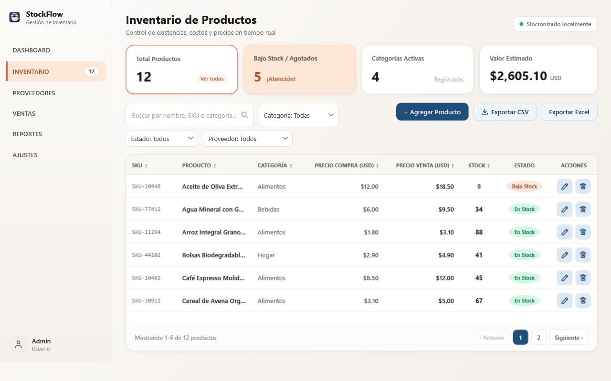
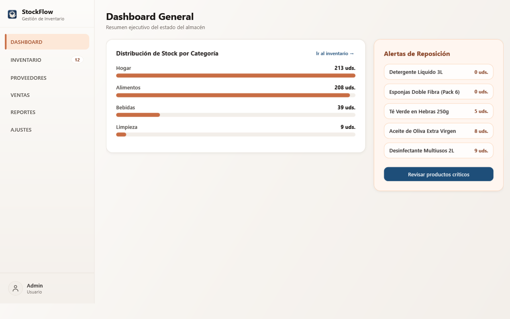
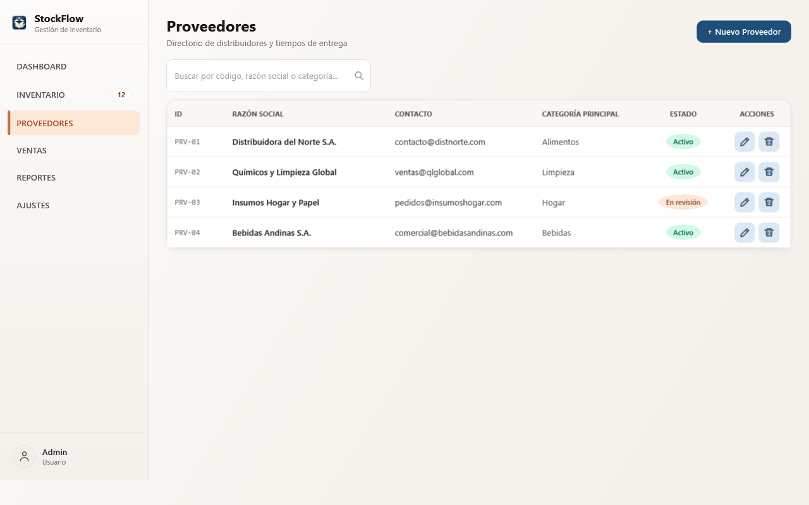
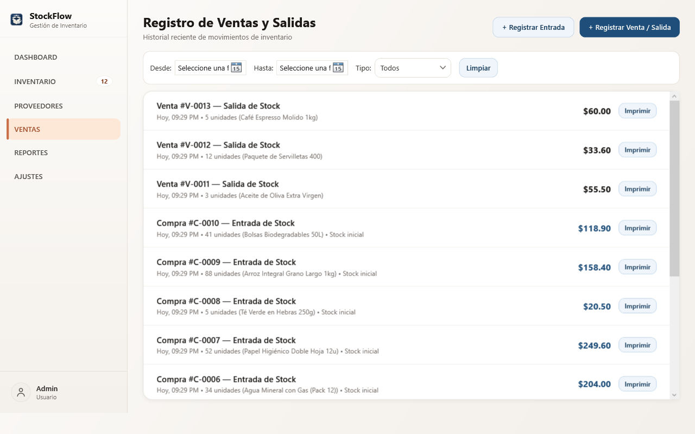
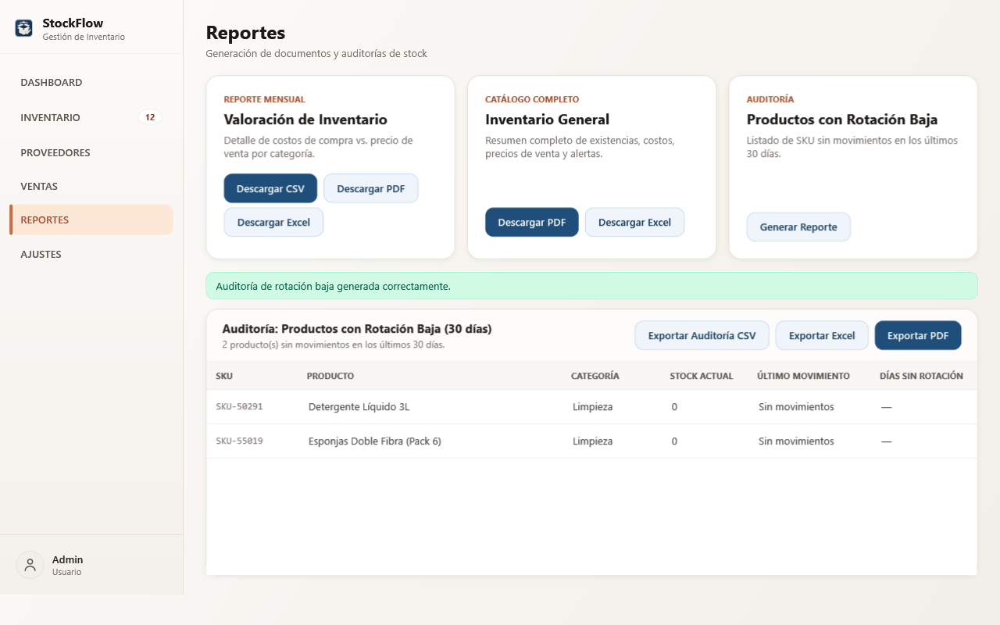
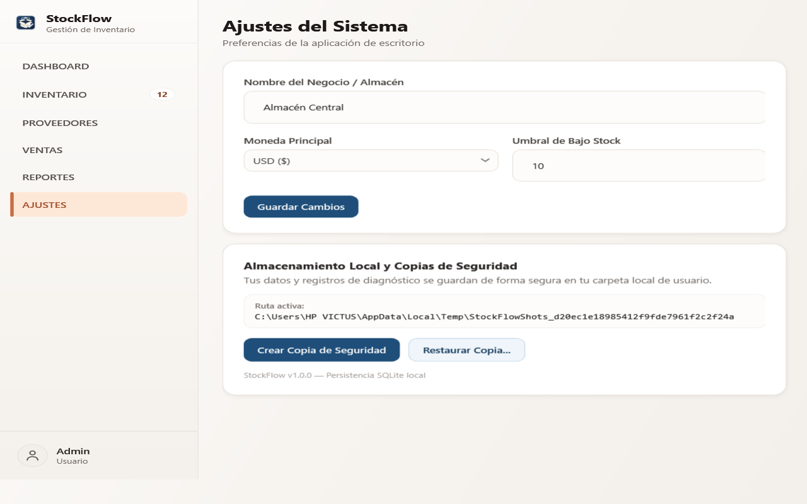

# StockFlow (`TiendaBodegas`)

Aplicación de escritorio para Windows (`.NET 10` / `WPF`) orientada a la gestión integral de inventario en almacén único, directorio de proveedores, entradas y salidas de stock, tickets térmicos de 80 mm, exportación CSV/PDF/Excel, persistencia local SQLite con copias de seguridad verificadas y soporte multimoneda (`USD`, `COP`, `EUR`).

---

## Características principales

- **Arquitectura Clean Architecture + MVVM:** separación estricta entre `Domain`, `Application`, `Infrastructure` y `UI` (`CommunityToolkit.Mvvm` + `Microsoft.Extensions.DependencyInjection`).
- **Inventario unificado:** 4 tarjetas KPI interactivas, búsqueda en tiempo real, filtros por categoría/estado/proveedor, ordenamiento multipágina, paginación adaptativa al alto de ventana y exportación CSV (RFC-4180) y Excel (`.xlsx`).
- **Directorio de proveedores:** códigos `PRV-XX`, estados (`Activo` / `En revisión`), formularios validados con `INotifyDataErrorInfo` y bloqueo de eliminación si existen productos vinculados.
- **Ventas y movimientos:** registro validado de entradas y salidas, tarjetas con fechas relativas (`Hoy` / `Ayer`), filtros por rango y tipo, e impresión de comprobantes térmicos de **80 mm** (`FlowDocument`).
- **Reportes y exportaciones:** valoración por categoría (CSV, PDF y Excel), inventario general (PDF y Excel) y auditoría de baja rotación a 30 días (vista previa, CSV, PDF y Excel) con `QuestPDF` y `ClosedXML`.
- **Multimoneda con tasa diaria:** conversión automática entre `USD`, `COP` y `EUR` mediante `DailyExchangeRateService` (API primaria, failover secundario, caché diario y respaldo sin conexión) con propagación inmediata a vistas y reportes.
- **Persistencia SQLite, respaldos y diagnósticos:** base de datos local en `%LOCALAPPDATA%\StockFlow\tiendabodegas.db`, migración transaccional automática desde JSON legado, copias de seguridad/restauración con verificación `PRAGMA integrity_check` y copia preventiva automática (`backups/pre-restore-*.db`), logging diario con `Serilog` (`logs/stockflow-*.log`) y captura global de excepciones.

---

## Capturas de pantalla

### Inventario de Productos


### Dashboard General


### Proveedores


### Registro de Ventas y Salidas


### Reportes y Auditoría


### Ajustes, Almacenamiento y Respaldos


---

## Estructura de la solución

- `src/TiendaBodegas.Domain`: entidades (`Product`, `Supplier`, `StockMovement`, `Inventory`, `AppSettings`), enumeraciones (`MovementType`, `SupplierStatus`) e interfaces de repositorio.
- `src/TiendaBodegas.Application`: lógica de aplicación (`InventoryManager`, `CatalogManager`, `SettingsManager`, `InventoryCsvExporter`), DTOs, validaciones e interfaces (`IInventoryService`, `ICatalogService`, `ISettingsService`, `IExchangeRateService`, `IInventoryExportService`, `IExcelExportService`, `IPdfExportService`, `IPrinterService`, `IDatabaseBackupService`, `IAppLogger`).
- `src/TiendaBodegas.Infrastructure`: resolución de rutas de usuario (`AppDataPaths`), SQLite (`SqliteDataContext`, `SqliteSchemaMigrator`, repositorios SQLite, `SqliteBackupService`, `JsonToSqliteMigrator`), respaldo/lectura JSON legado (`JsonDataContext`), exportación PDF (`QuestPdfExportService`), exportación Excel (`ClosedXmlExcelExportService`), tasa de cambio (`DailyExchangeRateService`) y logging (`SerilogAppLogger`).
- `src/TiendaBodegas.UI`: proyecto WPF (`StockFlow.exe`, `net10.0-windows`) con temas (`Themes/`), convertidores (`Converters/`), impresión térmica (`WpfPrinterService`), manejo global de errores (`App.xaml.cs`), ViewModels y vistas XAML.
- `tests/TiendaBodegas.Tests`: suite automatizada `xUnit` (`65/65` pruebas en `13` clases, `0` advertencias y `0` errores).
- `installer/StockFlow.iss` y `scripts/publish-release.ps1`: automatización de publicación Release, paquete portable `.zip` e instalador Windows con Inno Setup 6.

---

## Almacenamiento local y respaldos

- **Base de datos activa:** `%LOCALAPPDATA%\StockFlow\tiendabodegas.db` (esquema relacional versionado en `SchemaVersions` v1 con claves foráneas `ON DELETE RESTRICT`).
- **Promoción automática:** si `%LOCALAPPDATA%\StockFlow` está vacío al iniciar y existen datos previos en `bin/.../data/` o `%LOCALAPPDATA%\TiendaBodegas`, los archivos se copian automáticamente conservando el origen como respaldo; los `.json` heredados se importan transaccionalmente mediante `JsonToSqliteMigrator`.
- **Copias de seguridad:** desde **Ajustes → Almacenamiento Local y Copias de Seguridad** se puede crear y restaurar respaldos `.db` (con copia preventiva automática en `%LOCALAPPDATA%\StockFlow\backups\`).
- **Logs de diagnóstico:** archivos diarios UTF-8 en `%LOCALAPPDATA%\StockFlow\logs\stockflow-YYYYMMDD.log` (retención de 14 días).

---

## Compilación, ejecución y pruebas

La solución está definida en `TiendaBodegas.slnx`.

```powershell
# Compilar toda la solución
dotnet build TiendaBodegas.slnx

# Ejecutar la aplicación WPF (StockFlow)
dotnet run --project src/TiendaBodegas.UI

# Ejecutar todas las pruebas automatizadas (65/65)
dotnet test TiendaBodegas.slnx
```

---

## Empaquetado y release (Windows x64)

```powershell
# Generar compilación Release self-contained, paquete portable .zip e instalador (si Inno Setup 6 está instalado)
powershell -ExecutionPolicy Bypass -File scripts/publish-release.ps1
```

Salidas generadas en `artifacts/release/`:
- `StockFlow-1.0.0-win-x64-portable.zip`
- `StockFlow-Setup-1.0.0-win-x64.exe` (compilado desde `installer/StockFlow.iss` cuando `ISCC.exe` está disponible en el equipo)

---

## Estado del roadmap

### Etapas completadas (`MVP 1`–`MVP 5`, `R0`–`R10`, `N1`–`N7`)
- [x] **R0–R10 (MVP 4):** refactor visual, pivote a proveedores en almacén único, 6 secciones operativas, tasa de cambio diaria y pruebas E2E.
- [x] **N1. Tickets imprimibles (80 mm):** `IPrinterService` + `WpfPrinterService` (`FlowDocument`).
- [x] **N2. Exportación PDF:** `IPdfExportService` + `QuestPdfExportService` (`QuestPDF` Community).
- [x] **N3. Reportes Excel:** `IExcelExportService` + `ClosedXmlExcelExportService` (`ClosedXML`).
- [x] **N4. Migración a SQLite:** esquema versionado v1, repositorios SQLite y `JsonToSqliteMigrator`.
- [x] **N5. `%LOCALAPPDATA%\StockFlow`, backup y observabilidad:** `AppDataPaths`, `SqliteBackupService` con UI en Ajustes, `SerilogAppLogger` y manejo global de excepciones.
- [x] **N6. Empaquetado y release:** binario `StockFlow.exe`, `installer/StockFlow.iss`, `scripts/publish-release.ps1`, capturas reales en `docs/screenshots/` y `README.md` final.
- [x] **N7. Versionado de `docs/`:** documentación técnica y capturas habilitadas para seguimiento en Git desde `.gitignore`.

### Backlog diferido — ESPERA (`E1`–`E6`)
- [x] **E1.** Retirado el código heredado sin uso (`Shipment`, `ShipmentStatus`, `DispatchManager`, `ShipmentPlanDto` y `PrinterService`).
- [ ] **E2.** Soporte multi-bodega / sucursales o motor SQL cliente-servidor.
- [ ] **E3.** Autenticación, usuarios y roles reales (el pie `Admin / Usuario` es actualmente informativo).
- [ ] **E4.** Lectura y generación de códigos de barras / QR.
- [ ] **E5.** Gráficos estadísticos avanzados en el Dashboard.
- [ ] **E6.** Versión web.

## Convenciones activas del proyecto

- **Arquitectura:** Clean Architecture + MVVM estricta (`code-behind` sin lógica de negocio; ViewModels consumen solo interfaces de `Application`/`Domain` e `IDialogService`).
- **Idioma y documentación:** identificadores en inglés con comentarios XML (`/// <summary>`) en clases, constructores y métodos; UI y documentación en español; conservar las claves `[JsonPropertyName]` existentes.
- **Notas WPF:** al usar `<UseWPF>true</UseWPF>`, importar explícitamente `using System.IO;` en UI y pruebas cuando se utilicen `Path`, `File` o `Directory`.
